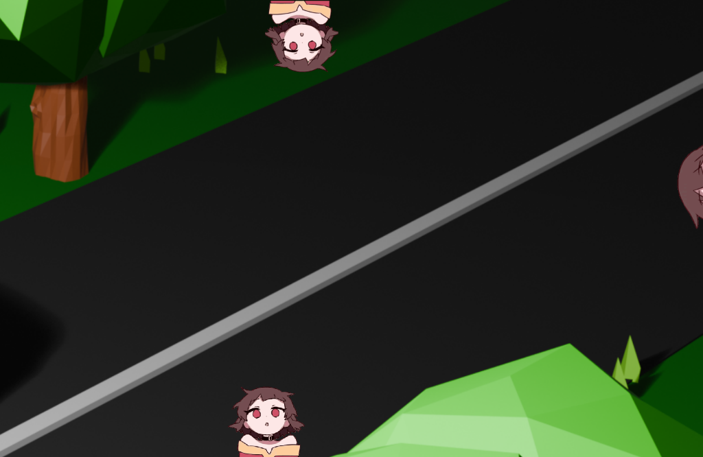
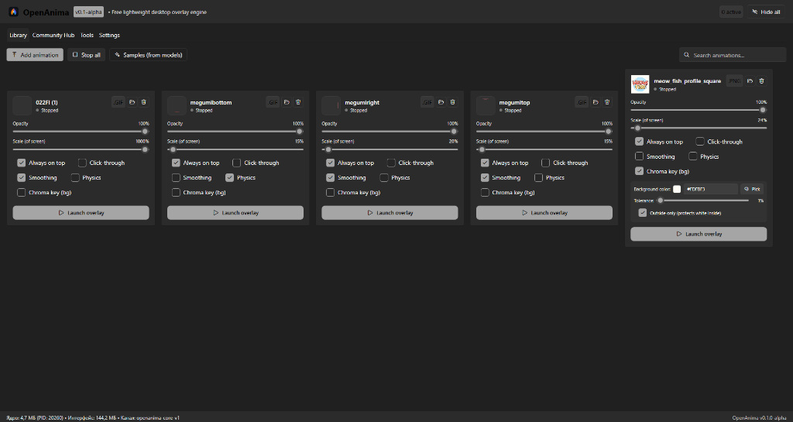
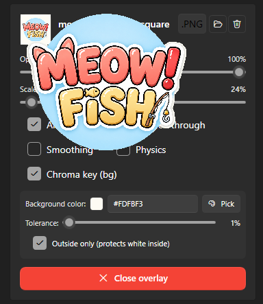
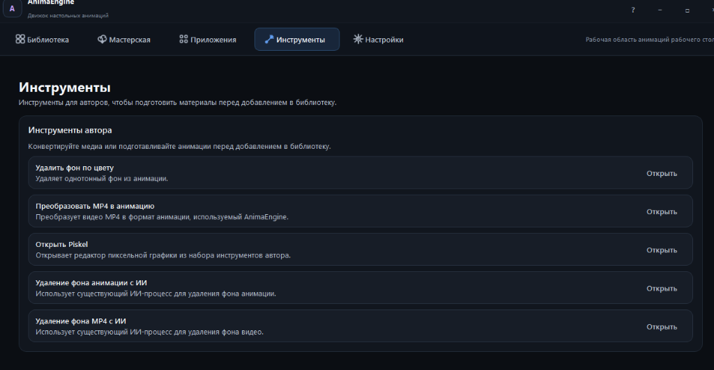

<p align="center">
  
</p>

# OpenAnima

<p align="center">
  <b>Высокопроизводительный, открытый и ультра-легковесный движок оверлеев поверх игр для Windows.</b>
</p>

<p align="center">
  <a href="README.md">English</a> • <a href="README.ru.md"><b>Русский</b></a>
</p>

<p align="center">
  
  
  
  
  <a href="https://github.com/fobakic/OpenAnima/releases"></a>
</p>

---

## О проекте / About

**OpenAnima** — это свободная альтернатива тяжелым коммерческим движкам настольных анимаций и оверлеев (таким как `AnimaEngine` в Steam).

Оригинальные приложения на базе Python и Kivy/PySide6 весят гигабайты, запускают тяжелые интерпретаторы на каждую анимацию, потребляют сотни мегабайт оперативной памяти и вызывают микрофризы в играх. 

**OpenAnima** построена на современной гибридной архитектуре:
* **Интерфейс управления (C# .NET 8 / WPF-UI)**: нативный Fluent Design (Mica) в стиле Windows 11, адаптивная сетка карточек, моментальный отклик и поддержка мультиязычности (English / Русский) на лету.
* **Ядро оверлеев (Rust Microcore)**: компактный (~1.0 МБ) сервис, который отрисовывает прозрачные окна поверх любых DirectX/Vulkan игр через Win32 API (`UpdateLayeredWindow`), декодирует GIF/APNG без лишних копий памяти и ограничен на уровне ядра ОС через **Windows Job Object**.

---

## Сравнение с оригиналом (AnimaEngine)

Оригинальное приложение найдено в системе по пути:
`C:\Program Files (x86)\Steam\steamapps\common\AnimaEngine` *(Steam AppID: 3474900)*.

### Сводная таблица сравнения

| Параметр | Оригинал (AnimaEngine Steam) | **OpenAnima (v0.1.0-alpha)** | Преимущество OpenAnima |
| :--- | :--- | :--- | :--- |
| **Размер на диске** | **~3 005 МБ** *(3.0 ГБ)* | **8.9 МБ** *(Standalone)* / **3.9 МБ** *(ZIP)* | **В 350–870 раз меньше!** |
| **Потребление RAM (4 оверлея)** | 300–600+ МБ *(растущие утечки)* | **16.9 МБ** *(зафиксировано в Диспетчере задач)* | **В 20–30 раз экономичнее** |
| **Потребление RAM при простое** | 120–180 МБ (GUI) | **~15 МБ** *(агрессивный сброс Working Set)* | **В 10 раз меньше** |
| **Количество процессов** | Отдельный `python.exe` на анимацию + GUI | **1 процесс ядра + 1 процесс GUI** | Чистый диспетчер задач |
| **Утечки памяти и GDI** | Встроен костыль `memoryClean.exe` для очистки | **0% утечек**, контроль Windows Job Object | Идеальная стабильность |
| **Скорость старта оверлея** | 2–3 секунды *(через sub-process)* | **< 15 миллисекунд** *(Win32 API)* | Мгновенный запуск |
| **Влияние на FPS в играх** | Заметные просадки и микрофризы (GIL) | **0% влияния на FPS** | Без задержек в CS2, Warzone и др. |
| **Удаление фона (Хромакей)** | Отдельная утилита с пересохранением файла | **На лету в реальном времени прямо в карточке** | Пипетка цвета + умная защита надписей |
| **Локализация (i18n)** | Частичный испанский/русский из JSON | **Английский (по умолчанию) + Русский** | Мгновенное переключение (Пункт #1 настроек) |
| **Зависимости и запуск** | Требует Steam, Python 3.10, PySide6, ffmpeg | **Один автономный .exe без установки** | Запустил и пользуешься |
| **Лицензия** | Платная коммерческая | **MIT (бесплатно, открытый исходный код)** | 100% свобода |

---

## Визуальное сравнение (Скриншоты)

### 1. Реальные оверлеи поверх экрана (Live Desktop Overlay)
Прозрачные анимации персонажей без рамок, работающие одновременно по краям экрана поверх любых обоев или DirectX/Vulkan игр с нулевым мерцанием и 0% влияния на FPS:

<p align="center">
  
</p>

---

### 2. Библиотека OpenAnima (English по умолчанию и Русский интерфейс)
Адаптивная сетка карточек, плавная регулировка прозрачности и масштаба, компактный хромакей и кнопки со скругленными углами:

| English (Default) | Русский интерфейс |
| :---: | :---: |
|  |  |

---

### 3. Хромакей на лету с умной защитой надписей
Встроен прямо в карточку анимации. Алгоритм непрерывной заливки (*Flood Fill*) стартует снаружи и удаляет фон вокруг персонажа, **не повреждая белый цвет внутри надписей и глаз**:

| Английский интерфейс (Активный оверлей) | Русский интерфейс (Активный оверлей) |
| :---: | :---: |
|  |  |

---

### 4. Настройки: Выбор языка — Пункт #1
По запросу пользователей выбор языка расположен **самым первым пунктом** в Настройках, а динамическое переключение применяется мгновенно ко всем окнам, карточкам, статус-бару и контекстному меню трея:

<p align="center">
  
</p>

---

### 5. Реальное потребление памяти: 4 персонажа = всего 16.9 МБ RAM!
Зафиксированное потребление микроядра Rust в Диспетчере задач Windows при одновременной активной анимации 4 персонажей на экране:

<p align="center">
  
</p>

---

### 6. Оригинальный интерфейс AnimaEngine (Steam)
Для сравнения — интерфейс оригинального приложения на базе PySide6/Kivy:

| Мастерская оригинала | Инструменты автора оригинала |
| :---: | :---: |
|  |  |

---

## Архитектура системы

```
OpenAnima.UI (C# .NET 8 / WPF-UI Fluent Design)
       │
       │ Именованный канал Windows (`\\.\pipe\openanima-core-v1`)
       ▼
OpenAnima.Core (Rust Microcore ~1.0 MB)
       │
       ├── Win32 Layered Window Engine (UpdateLayeredWindow)
       ├── Zero-Copy Streaming APNG / GIF Decoder
       ├── Real-time Chroma Key (Boundary Flood-Fill & Tolerance)
       └── Windows Job Object (Kernel-level RAM & Safety Limiter)
```

1. **OpenAnima.UI**: отвечает исключительно за презентационный слой. При сворачивании в трей очищает свой рабочий набор (*Working Set*) до ~15 МБ.
2. **OpenAnima.Core**: ультра-оптимизированное микроядро на Rust. Отрисовывает кадры напрямую в видеопамять Windows DWM. Не использует тяжелые браузерные движки (Chromium/Electron/QtWebEngine).
3. **Безопасность**: ядро управляется через Windows Job Object с жестким лимитом памяти — процесс ядра физически не может разрастись или зависнуть в фоне.

---

## Форматы сборки и релизы

Готовые сборки опубликованы в [**разделе Releases**](https://github.com/fobakic/OpenAnima/releases/tag/v0.1.0-alpha) или собираются локально через `build.ps1` в папку `releases/`:

| Файл | Размер | Описание | Скачать |
| :--- | :--- | :--- | :--- |
| **Standalone Single-File EXE** | **8.9 МБ** | **Рекомендуется.** Единый исполняемый файл с упакованным ядром Rust. Распаковывается автоматически. | [⬇️ Скачать EXE](https://github.com/fobakic/OpenAnima/releases/download/v0.1.0-alpha/OpenAnima-v0.1.0-alpha-standalone.exe) |
| **Портативный ZIP-архив** | **3.9 МБ** | Портативный архив со всеми бинарниками и документацией. Распакуйте в любую папку и запускайте. | [⬇️ Скачать ZIP](https://github.com/fobakic/OpenAnima/releases/download/v0.1.0-alpha/OpenAnima-v0.1.0-alpha-portable.zip) |
| **Контрольные суммы SHA-256** | < 1 КБ | Криптографические хэши для проверки подлинности и целостности файлов. | [⬇️ Открыть суммы](https://github.com/fobakic/OpenAnima/releases/download/v0.1.0-alpha/SHA256SUMS.txt) |

### Автосборка из исходников

```powershell
# Запуск автоматической сборки всех релизов:
.\build.ps1

# Или через командную строку:
.\build.bat
```

Все собранные пакеты автоматически сохраняются в папку `releases/`.

---

## Дорожная карта (Roadmap)

- [x] **Фаза 1: Базовое ядро, оптимизация и UI (v0.1-alpha)**
  - [x] Ядро на Rust с ультранизким потреблением RAM (<20 МБ на 4 анимации).
  - [x] Нативный C# UI на базе WPF-UI (Fluent Design / Mica, тёмная тема).
  - [x] Адаптивная растягиваемая сетка карточек библиотеки.
  - [x] Drag & Drop добавление медиафайлов (GIF, APNG, PNG, WEBP).
  - [x] Безопасность через Windows Job Object и именованные каналы.
  - [x] Хромакей в реальном времени с пипеткой цвета и защитой надписей.
  - [x] Плавные оптимизированные ползунки с защитой от спама IPC.
  - [x] Полная мультиязычность (i18n): English по умолчанию + Русский.
  - [x] Переключатель языка как пункт #1 в Настройках.
  - [x] Автоматический сборщик единого EXE, Portable ZIP и Self-Contained версий.
- [ ] **Фаза 2: Инструменты и профили (v0.2)**
  - [ ] Профили оверлеев (Игры / Работа / Отдых) с горячими клавишами.
  - [ ] Встроенный конвертер коротких видео MP4 -> оптимизированный APNG.
  - [ ] Физика падения и броска персонажей мышкой с отскоком от панели задач.
- [ ] **Фаза 3: Открытый каталог сообщества (v0.3)**
  - [ ] Каталог анимаций OpenAnima Hub (бесплатная альтернатива Workshop через GitHub/CDN).
  - [ ] Модульный плагин удаления фона с искусственным интеллектом (Rembg/ONNX).

---

## Лицензия

Проект распространяется под свободной лицензией **MIT**. Подробности в файле [LICENSE](LICENSE).
