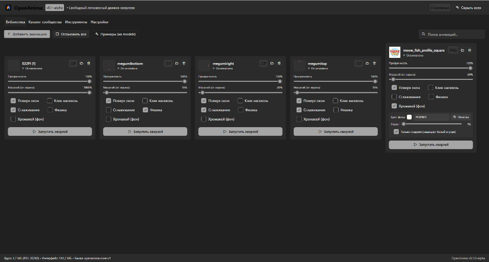
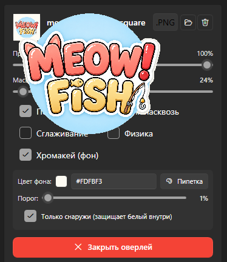
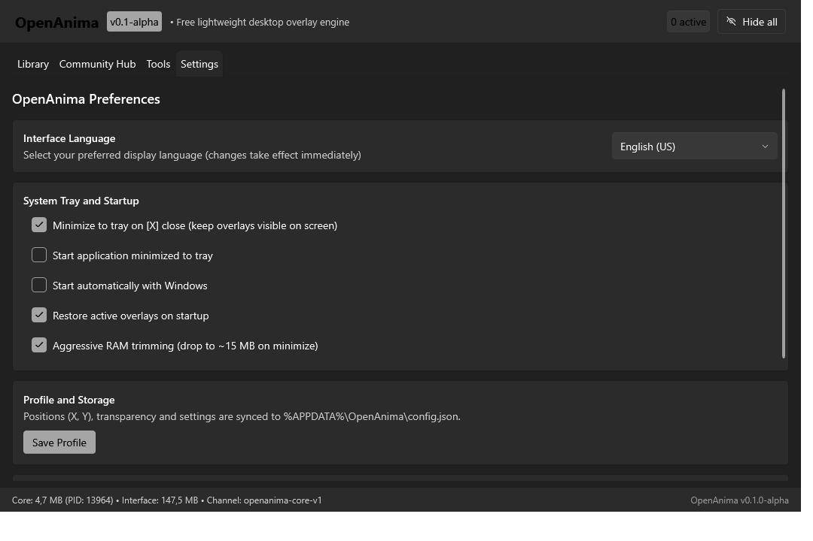
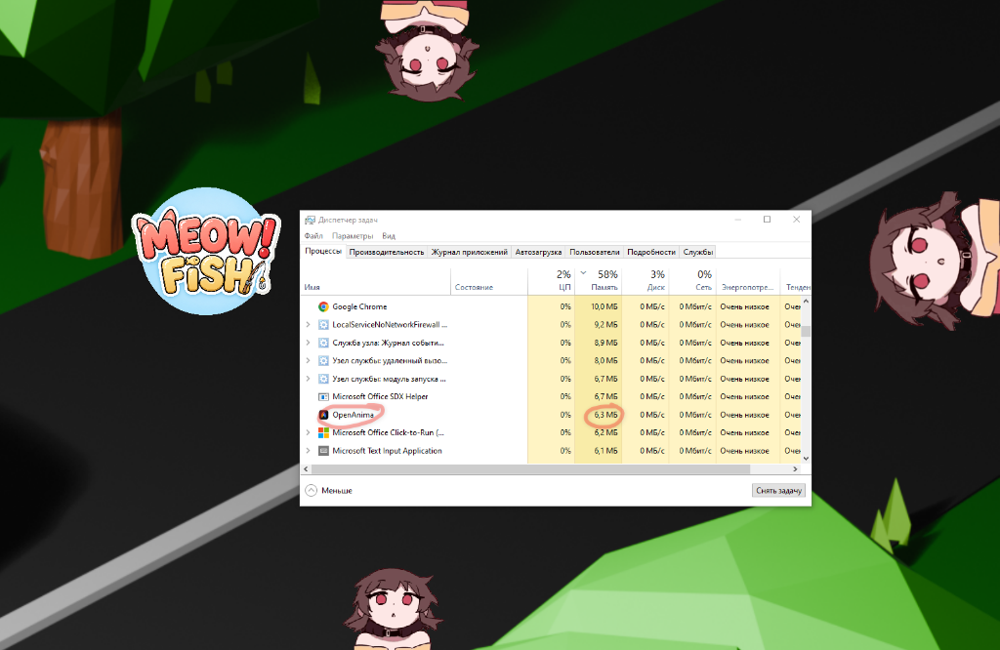
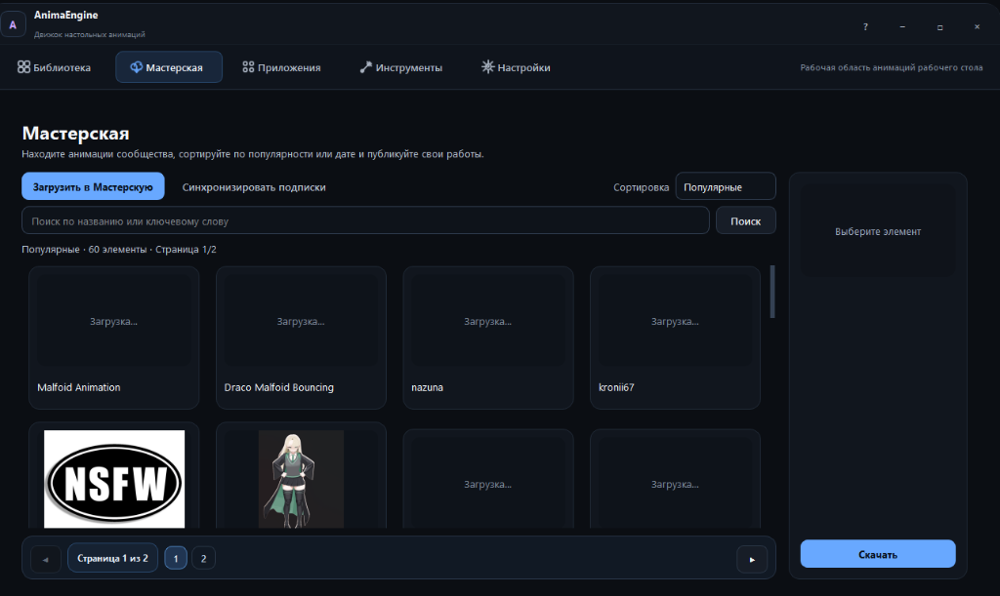

<p align="center">
  
</p>

# OpenAnima

<p align="center">
  <b>High-performance, open-source, ultra-lightweight desktop character overlay engine for Windows.</b>
</p>

<p align="center">
  <a href="README.md"><b>English</b></a> • <a href="README.ru.md">Русский</a>
</p>

<p align="center">
  
  
  
  
  <a href="https://github.com/fobakic/OpenAnima/releases"></a>
  <a href="https://hub.xerj.org/contributors/fobakic"></a>
</p>


---

## About OpenAnima

**OpenAnima** is a free and open-source alternative to heavy commercial desktop overlay and companion engines (such as Steam's `AnimaEngine`).

Legacy Python-based overlay apps consume hundreds of megabytes of RAM, launch separate heavy Python interpreter subprocesses for each animation, bloat disk space to gigabytes, and cause micro-stutters in games. 

**OpenAnima** is built on a clean modern hybrid architecture:
* **UI Front-End (C# .NET 8 / WPF-UI)**: native Windows 11 Fluent Design with Mica dark theme, responsive stretched card grid, instant response, and seamless runtime language switching (English / Russian).
* **Overlay Engine (Rust Microcore)**: a compact (~1.0 MB) service that renders transparent windows over any DirectX/Vulkan game using Win32 `UpdateLayeredWindow`, decodes streaming GIF/APNG with zero-copy memory buffers, and is guarded at kernel level via **Windows Job Objects**.

---

## Benchmark & Comparison with Original (AnimaEngine)

Comparison against the original Steam commercial application (`Steam AppID: 3474900`):

| Metric | Original (Steam AnimaEngine) | **OpenAnima (v0.2.0)** | OpenAnima Advantage |
| :--- | :--- | :--- | :--- |
| **Disk Size** | **~3,005 MB** *(3.0 GB)* | **8.5 MB** *(Standalone)* / **3.4 MB** *(ZIP)* | **350x – 870x smaller** |
| **Active RAM (4 overlays)** | 300–600+ MB *(growing leaks)* | **6.3 MB** *(verified in Windows Task Manager)* | **50x – 100x less memory** |
| **Idle RAM (Minimized)** | 120–180 MB (GUI) | **~15 MB** *(aggressive working set trim)* | **10x lighter** |
| **Process Count** | 1 `python.exe` process per overlay + GUI | **1 core process + 1 GUI process** | Clean task manager |
| **Memory / GDI Leaks** | Ships bundled `memoryClean.exe` workaround | **0% leaks**, enforced by Windows Job Object | Rock-solid stability |
| **Overlay Launch Latency** | 2–3 seconds *(spawning subprocess)* | **< 15 milliseconds** *(Win32 API)* | Instantaneous launch |
| **Game FPS Impact** | Noticeable stutters due to Python GIL | **0% FPS drop** in DirectX/Vulkan games | Esports-ready |
| **Background Removal (Chroma)** | External tool requiring file resave | **Built-in live real-time chroma key per card** | Color eyedropper + inner text protection |
| **Localization (i18n)** | Incomplete JSON files | **English (default) + Russian** | Instant switch (Card #1 in Settings) |
| **Dependencies** | Requires Steam, Python 3.10, PySide6, ffmpeg (390 MB) | **Single standalone .exe with zero prerequisites** | Click and run anywhere |
| **License** | Paid commercial / proprietary | **MIT (Free & Open Source)** | 100% freedom |

---

## Visual Showcase & Screenshots

### 1. Live Desktop Overlay in Action
Transparent borderless character animations running concurrently along screen edges over any wallpaper or DirectX/Vulkan game with zero background boxes, zero flicker, and zero FPS drop:

<p align="center">
  
</p>

---

### 2. OpenAnima Library (English Default & Russian Interface)
Responsive auto-stretching card grid, real-time opacity and scale sliders, compact chroma key panel, and rounded controls:

| English (Default) | Russian Interface |
| :---: | :---: |
|  |  |

---

### 3. Real-time Chroma Key with Text Protection
Built directly into each library card. Boundary flood-fill removes outer green/white background on the fly while **protecting inner whites (eyes, labels, text)**:

| English Controls (Active Overlay) | Russian Controls (Active Overlay) |
| :---: | :---: |
|  |  |

---

### 4. Settings: Interface Language is Item #1
Language selector is prominently placed as **Card #1** at the very top of Settings. Dynamic switching takes effect immediately across all windows, tabs, status bar, and tray menu without restarting:

<p align="center">
  
</p>

---

### 5. Real Memory Benchmark: 4 Active Overlays = 6.3 MB RAM
Verified resource consumption in Windows Task Manager running 4 concurrent active character overlays on screen — just **6.3 MB RAM**, **0% CPU**, and zero disk load:

<p align="center">
  
</p>

---

### 6. Legacy Original Interface (Steam AnimaEngine)
For visual comparison — original PySide6/Kivy interface:

| Original Workshop | Original Creator Tools |
| :---: | :---: |
|  |  |

---

## System Architecture

```
OpenAnima.UI (C# .NET 8 / WPF-UI Fluent Design)
       │
       │ Windows Named Pipe (`\\.\pipe\openanima-core-v1`)
       ▼
OpenAnima.Core (Rust Microcore ~1.0 MB)
       │
       ├── Win32 Layered Window Engine (UpdateLayeredWindow)
       ├── Zero-Copy Streaming APNG / GIF Decoder
       ├── Real-time Chroma Key (Boundary Flood-Fill & Tolerance)
       └── Windows Job Object (Kernel-level RAM & Safety Limiter)
```

1. **OpenAnima.UI**: handles the presentation layer. When minimized to the system tray, it aggressively trims its working set down to ~15 MB.
2. **OpenAnima.Core**: ultra-optimized native Rust microcore. Renders frames directly to Windows DWM video memory. No Chromium, Electron, or QtWebEngine bloat.
3. **Safety**: the core runs under a Windows Job Object with strict memory limits — it can never run away with resources.

---

## Download Releases & Automated Builds

Pre-built releases are available in the [**Releases section**](https://github.com/fobakic/OpenAnima/releases/tag/v0.2.0) or generated automatically via `build.ps1` into `releases/`:

| Package | Size | Description | Download |
| :--- | :--- | :--- | :--- |
| **Standalone Single-File EXE** | **8.4 MB** | **Recommended.** Single executable with embedded Rust microcore. Auto-extracts on first run. | [⬇️ Download EXE](https://github.com/fobakic/OpenAnima/releases/download/v0.2.0/OpenAnima-v0.2.0-standalone.exe) |
| **Portable ZIP Archive** | **3.7 MB** | Portable zip archive with all binaries and documentation. Extract and run anywhere. | [⬇️ Download ZIP](https://github.com/fobakic/OpenAnima/releases/download/v0.2.0/OpenAnima-v0.2.0-portable.zip) |
| **SHA-256 Checksums** | < 1 KB | Cryptographic hashes to verify package authenticity and integrity. | [⬇️ View Checksums](https://github.com/fobakic/OpenAnima/releases/download/v0.2.0/SHA256SUMS.txt) |

### Build from Source

```powershell
# Run the automated release builder:
.\build.ps1

# Or via command prompt:
.\build.bat
```

All build artifacts will be placed in `releases/`.

---

## Roadmap

- [x] **Phase 1: Core Engine, Performance & UI Polish (v0.1-alpha)**
  - [x] High-performance Rust microcore with zero memory leaks (< 20 MB for 4 overlays).
  - [x] Native C# UI with WPF-UI (Fluent Design / Mica, dark theme).
  - [x] Responsive auto-stretching card grid.
  - [x] Drag & Drop media file import (GIF, APNG, PNG, WEBP).
  - [x] Windows Job Object sandboxing and named pipe IPC.
  - [x] Real-time chroma key with color picker and text protection.
  - [x] Throttled smooth sliders with IPC spam protection.
  - [x] Full i18n localization: English default + Russian.
  - [x] Language selector as Item #1 in Settings.
  - [x] Automated release build script producing Standalone EXE, Portable ZIP, and Self-Contained packages.
- [x] **Phase 2: Tools & Profiles (v0.2)**
  - [x] Profile presets (Gaming / Work / Chill) with hotkeys.
  - [x] Built-in MP4 -> optimized APNG video converter.
  - [x] Gravity physics and mouse throw with taskbar bouncing.
- [ ] **Phase 3: Open Community Hub (v0.3)**
  - [ ] OpenAnima Hub animation catalog (free open-source Steam Workshop alternative via GitHub/CDN).
  - [ ] Modular AI background removal plugin (Rembg/ONNX).

---

## License

This project is licensed under the terms of the **MIT License**. See [LICENSE](LICENSE) for details.
